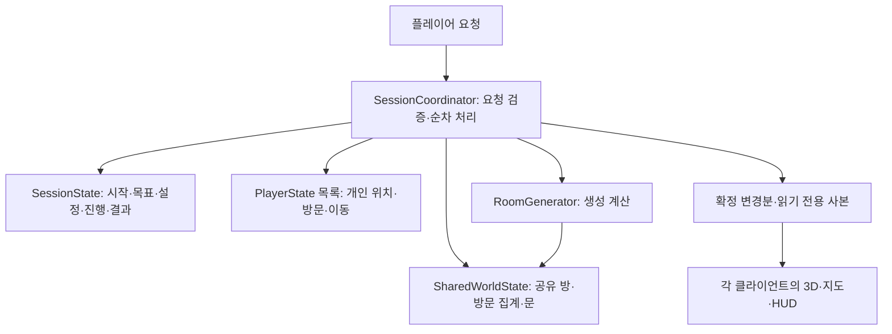

# WordRoom — 협동 플레이를 위한 상태 분리 설계

작성일: **2026-10-27 (한국 시간)**  
검토 기준: HEAD `15b8c90`, 기능 구현 기준 `430dfbb`  
상태: **2026-10-27 설계 기록 / 1단계 상태 분리는 `48e25a0`에 구현·커밋 / 정책 일부 미결정**

**2026-10-31 최신 안내(HEAD `bf9a164`):** 아래 본문은 10월 27일 설계 당시의 문제·제안 기록이다. 기존 상태 분리·로비·공동 시작·탐색/복구·원격 로봇/지도에 이어 더블클릭 입장 `1968b2f`, 자유 그리기 메모/협동 공유 `170a7e2`, 개인 게임당 1회 끼임방지·협동 결과 UI·GUEST 시작 숨김 `bf9a164`가 구현·자산 적용·커밋됐고 사용자 검증 완료 통보가 있다. 과거 미구현 표기를 현재 할 일로 해석하지 않는다. 재접속·호스트 인계는 사용자 결정으로 현재 범위에서 제외한다. 요청 도착 FIFO는 임시이며 근접 동시 호스트 우선의 시간 범위는 미정이다. 현재 상세는 [인수인계](00_프로젝트_인수인계.md)와 [전체 개발 계획 9·11장](01_전체개발계획_및_진행현황.md)을 우선한다. KI-001·009·011·013·014의 보류를 유지한다. KI-012는 region 관련 사용자 추정과 서버 설정 변경 후 현재 재발 없음 보고를 반영하며 원인 확정으로 취급하지 않는다.

**구체화된 정책:** 끼임방지는 Return 요청·ReturnMarks로 일반 이동과 분리해 진행을 보존하며 코디네이터와 확정 표시 상태가 개인당 게임 1회를 검사한다. 버튼은 ‘끼임방지 (1회)’, 하단 설명 없음, 사용 후 비활성이다. 협동 결과는 공동 시간·팀 방문·참가자 전원 최대 4명의 개인 방문을 표시하고 각자 메인 메뉴로 복귀한다. 그림 메모는 지도 좌표에 저장하고 본인만 지울 수 있으며 새 게임에서 초기화한다. 영구 저장·텍스트 메모·재접속은 추가하지 않았다. 다음 절의 제안·미정 문구는 이 최신 정책과 충돌할 경우 당시 기록으로만 읽는다.

## 1. 목적과 범위

하나의 공유 지도에서 2~4명이 서로 다른 방을 탐색할 수 있도록 상태의 소유 범위와 변경 경로를 나눈다. 단독 플레이도 같은 구조에 플레이어 한 명을 등록해 사용한다.

이번 설계는 상태 분리와 기존 기능 연결을 다룬다. 대기실, Photon 메시지 구현, 위치 보간, 재접속, 호스트 인계, 공유 그림은 후속 단계다. 새 클래스 이름은 역할 설명용 제안이며 구현 확정이 아니다. 구현 프롬프트도 아직 작성하지 않는다.

목표 유도의 보정 수치·생성 규칙은 유지한다. **2026-10-27 사용자 합의로 협동 목표 유도 진행도는 팀 전체의 고유 방문 좌표 수를 사용한다.** 시작 좌표를 포함하고 재방문·팀원 간 중복 방문은 추가로 세지 않는다. 방 생성·문 열기만으로는 진행도가 늘지 않는다. KI-001·009 수정 보류도 유지한다.

## 2. 현재 코드에서 확인한 결합

| 현재 위치 | 함께 들어 있는 책임 | 분리가 필요한 이유 |
|---|---|---|
| `RoomMap` | 확정 방, 생성 순서, 생성 근거, 준비 기록, 미생성 사유, 최근 단어, 위치, 이동 수, 방문, 경로, 시작·목표, 종료 상태 | 지도 하나에 현재 위치 하나만 있어 분산 탐색을 표현할 수 없음 |
| `RoomGenerator` | 생성 계산, 현재 위치를 기준으로 한 Prepare·Enter, 방문·목표·이동 제한 처리 | 다른 플레이어의 요청을 처리하려고 전역 Position을 바꾸면 서로의 상태를 덮어씀 |
| `RoomWorldView` | 로컬 3D 표시와 `DoorStateStore` 소유 | 표시 범위와 오브젝트 수명에 공유 문 상태의 소유권이 묶임 |
| `MapUpdate`·`ExploredMap` | 생성 방·방문 표시와 Current 한 개 | 다른 사람의 방문을 별도 변경분으로 전달할 수 없음 |
| `RoomGenerationDebug` | 요청 실행, 로컬 이동 잠금, 지도·3D 갱신, 시간·결과 확정 | 로컬 표시 문제와 세션 전체 상태를 구분해야 함 |

중요한 현재 동작:

- `RoomMap.Recent`는 시작 단어와 새로 **생성·확정한 단어**의 이력이다. `Enter`는 최근 단어를 추가하지 않는다. 방문 이력으로 바꾸지 않는다.
- `IsPrepared`는 해당 방 주변의 생성 요청을 처리했다는 뜻이다. 주변 네 방의 생성 완료나 특정 문 통과 허가와 같지 않다.
- 문 상태는 열기 시작 때 Open으로 저장하고, 애니메이션 완료·목적지 준비·로컬 표시 조건을 별도로 확인해 통과시킨다.
- 현재 목표 시간은 로컬 조작 가능 시점부터 실제 목표 경계 통과 감지 시각까지다. 협동 시간 정책이 자동으로 정해지는 것은 아니다.

## 3. 제안 구조와 소유권

단독에서는 로컬 `SessionCoordinator`가 권한을 가진다. 협동에서는 호스트의 Coordinator가 확정 상태를 변경하고, 다른 클라이언트는 요청과 확정 사본을 다룬다. 생성기는 Coordinator의 처리 범위 안에서만 공유 생성 상태를 수정한다.

### 3.1 SharedWorldState — 세션당 하나

| 상태 | 내용 |
|---|---|
| 방 | 좌표 → 단어 ID, 생성 순서, `PlacedRoom`·연결 근거 |
| 주변 준비 | 방별 처리 완료 기록, 미생성 사유·이전 생성 시도 조건 |
| 생성 이력 | 최근 생성 단어와 순서, 최대 길이 |
| 공유 방문 집계 | 누군가 입장한 좌표의 집합. 개인 방문 기록에서 갱신하는 집계이며 UI가 수정하지 않음 |
| 문 | 정규화한 연결 ID → 열림 상태. 표시 오브젝트를 반환해도 유지 |

월드에는 전역 Current·Position을 두지 않는다. 준비 완료는 방 기준, 문 열림은 연결 기준이다. 열린 연결이어도 이동 방향의 목적지가 준비됐는지 각각 검사한다.

**2026-10-27 사용자 확정: 최근 생성 단어 이력은 월드 전체에서 하나로 공유·관리한다.** 누가 요청했든 생성 확정 순서대로 갱신한다. 기존 최근 이력 길이 설정은 유지하며 개인 방문 이력과 구분한다.

설명 보충(2026-10-27): 새 방의 단어는 그 좌표에 인접한 방들과의 연관성을 기준으로 고른다. 최근 생성 이력은 후보의 순위·추첨에 쓰는 다양성 보정 자료다. DB 경로는 인접 방들의 적격 후보를 구한 뒤 다양성 점수를 반영하고, fastText 보충도 인접 관계 품질을 우선한 후보 선택 안에서 이력을 참고한다.

### 3.2 PlayerState — 참가자당 하나

| 상태 | 내용 |
|---|---|
| PlayerId | 세션 안에서 식별하는 ID. 향후 재접속 식별·Photon 참가자와 연결하는 방법은 후속 설계 |
| Position | 마지막으로 확정된 논리 방 좌표 |
| Moves | 해당 플레이어의 실제 입장 횟수 |
| Visits·Path | 개인 좌표별 방문 횟수, 개인 이동 경로 |
| 참가 상태 | 연결·이탈 등 논리 참가 상태. 구체적 수명 정책은 재접속 단계에서 결정 |

카메라, Transform, CharacterController, 커서, 메뉴 입력 차단, 지도 확대·이동은 여기에 넣지 않는다. 이들은 각 기기의 표시·조작 상태다. 다른 플레이어에게 보여 줄 연속 위치·방향은 후속 위치 동기화 자료로 분리하며, 그 수신만으로 논리 입장·방문을 확정하지 않는다.

### 3.3 SessionState — 세션당 하나

- 세션 ID, 시작·목표 단어, 시드, 난이도·어휘 범위, 고정한 생성 설정, 데이터 패키지 ID.
- 준비·진행·성공·종료 같은 세션 단계와 성공 결과 1회 확정 여부.
- 시간 측정의 기준 정보와 확정 결과. 단독의 기존 시간 의미는 유지한다. 협동은 전원 데이터 준비·초기 배치 완료 후 공동 시작부터 첫 목표 입장을 호스트가 확정할 때까지 측정한다(2026-10-27 사용자 합의). 시작 이후 메뉴·지도·생성·통신 대기도 포함하며 결과는 팀 공통이다.
- 확정 변경 순번. 새 세션의 결과와 이전 세션의 늦은 결과를 구별한다.
- 참가자 목록 및 PlayerState 연결.

감도·음량·UI 크기·표시 반경 등 사용자 설정은 로컬에 남긴다. 협동 시작·목표·생성 설정과 같은 세션 설정과 구분한다.

### 3.4 LocalViewState — 각 기기

로컬 플레이어 ID, 3D 방·문 풀, 표시 반경, 로컬 지도 사본, HUD, 입력 잠금, 카메라, 지도 중심·배율, 표시 오류를 보관한다. 공유 월드의 복사본은 표시용이며 권한 원본이 아니다.

### 3.5 플레이어 외형 — 임시 박스와 후속 로봇 모델

**2026-10-27 사용자 결정:** 최종 외형은 애니메이션 필요성을 최소화한 간단한 로봇 형태로 한다. 실제 모델은 추후 추가하고, 플레이어 표시가 필요한 단계에서는 적당한 크기의 박스를 임시 외형으로 사용한다. 현재 외형을 구현하거나 로봇 모델을 제작한 상태는 아니다.

임시 외형의 구체 구성은 다음을 제안한다.

- 박스 크기는 기존 플레이어 높이 1.8m·반지름 0.3m에 맞춰 **폭 0.6m × 높이 1.8m × 깊이 0.6m**로 한다. 발밑을 플레이어 루트 원점으로 두고 박스 중심은 로컬 Y=0.9m에 둔다. 크기는 제안값이며 기존 이동·카메라 치수를 변경하지 않는다.
- 플레이어 루트 아래 `Visual` 자식에 박스를 둔다. 이후 로봇 모델은 이 자식의 외형만 교체한다. PlayerId, 논리 위치, 이동 제어, 카메라·충돌 기준은 외형과 분리한다.
- 임시 외형은 Animator·본·걷기 애니메이션 없이 이동과 수평 회전으로 표현한다. 최종 로봇의 세부 구조와 필요한 최소 애니메이션은 추후 결정한다.
- 로컬 1인칭 카메라에서는 자기 외형을 숨기고 다른 플레이어의 외형을 표시하는 방식을 제안한다. 외형 표시 여부가 논리 참가 상태를 바꾸지 않는다.
- 박스 자체에는 충돌체를 두지 않는다. 기존 플레이어끼리 서로 통과하는 규칙을 유지하고, 원격 외형이 통로·문 상호작용 Ray를 가로막지 않도록 표시·충돌 계층을 구분한다.
- 원격 외형은 후속 위치 동기화 자료를 따라 표시하며 로컬 입력·카메라를 실행하지 않는다. 외형이 움직였다는 이유로 입장·방문을 직접 확정하지 않는다.

## 4. 요청과 확정 변경의 경계

개념상 요청은 `SessionId / PlayerId / RequestId / ExpectedFrom / 목적지 또는 방향`을 가진다. 네트워크 도입 시 PlayerId는 송신자와 대조하며 요청 본문만 신뢰하지 않는다. 구체적인 전송 형식과 Photon API는 이번 범위가 아니다.

### 문 열기·Prepare

1. 요청자의 확정 위치, 인접성, 방 존재, 세션 진행 상태를 확인한다. 문 상호작용 거리·방향의 권한 검사는 후속 네트워크 단계에서 구체화한다.
2. 연결의 열림 변경과 목적지 주변 준비 결과를 순서가 있는 변경으로 처리한다. 문 열림과 준비 완료를 같은 상태로 간주하지 않는다.
3. 기존 방의 단어를 유지하고 비어 있는 주변만 기존 생성기로 채운다. 준비 요청은 요청자의 Position·Moves·Visits·성공을 변경하지 않는다.
4. 같은 연결이나 목적지에 요청이 겹쳐도 확정한 방을 덮어쓰지 않는다. 준비 결과의 재사용·재시도는 현재의 미생성 기록과 지도 변경 조건을 보존한다.
5. 애니메이션은 각 기기가 표시하고, 통과에는 공유 준비 조건과 로컬 표시·충돌 조건을 모두 요구한다. 협동 애니메이션 시간 기준은 네트워크 단계에서 정한다.

### 실제 입장·Enter

1. 요청의 ExpectedFrom과 요청자의 확정 Position을 대조한다. 그 사람의 현재 위치에서 목적지가 인접하고 존재하며, 연결이 열렸고 목적지 준비가 처리됐는지 확인한다.
2. 해당 플레이어의 Position·Moves·Visits·Path만 갱신한다.
3. 공유 방문 집계를 갱신한다. 결과에는 `개인 첫 방문`과 `팀 첫 방문`을 별도로 담는다.
4. 목표 단어 일치 여부로 세션 성공을 한 번만 확정한다. 이후 요청은 완료된 세션을 다시 변경하지 않는다.
5. 방 주변을 다시 생성하지 않는다. 입장 확정 후 로컬 표시 실패가 나도 확정 입장을 되돌리지 않는다.

정확한 물리 경계 통과 검증·통과 대기 시간·클라이언트 보정은 네트워크 단계 과제다. 현재 로컬 경계 감지와 호스트 논리 검사를 구분한다.

### 끼임방지·시작 방 복귀

**2026-10-27 사용자 확정 / 현재 구현 완료(`bf9a164`):** Esc 메뉴의 `끼임방지 (1회)`로 요청자만 시작 방에 복귀한다. 개인당 게임 1회·하단 설명 제거·진행 보존·단독/호스트 검사·사본 복구까지 반영됐다. 다음 목록은 당시 세부 제안이며 현재 구현은 문서 상단과 전체 개발 계획 9.8절을 따른다.

세부 구현 제안:

- 목적지는 세션 시작 방 `(0,0)`의 안전한 바닥 위치다. 단독에서는 본인, 협동에서는 요청자만 복귀한다.
- 일반 Enter와 구분한 복귀 요청으로 처리한다. 논리 Position, 실제 위치, 3D 표시 중심, HUD·지도 현재 위치를 함께 갱신한다. 협동에서는 호스트가 확정해 전파한다.
- 생성한 방·열린 문·생성 이력·개인 및 팀 방문 기록·경과 시간은 유지한다. 새 판 시작이나 단어 재생성을 하지 않는다.
- 복귀 자체는 일반 이동 수·방문 횟수에 추가하지 않는 방식을 제안한다. 경로에 남길 경우 복귀 이벤트로 구분한다. 이미 방문한 시작 방이므로 고유 방문 진행도는 늘지 않는다.
- 처리 중인 요청과 복귀를 순차 처리하고, 복귀 전 위치의 늦은 결과가 새 위치를 덮어쓰지 않도록 요청·배치 버전을 구분한다. KI-001 수정 완료로 취급하거나 임의 롤백하지 않는다.
- 시작 방 표시·바닥 배치가 준비된 뒤 메뉴를 닫고 조작을 재개하는 흐름을 제안한다. 표시 실패 시 복귀 성공으로 안내하거나 입력 잠금을 무조건 해제하지 않는다.
- 진행 중인 세션의 배치된 플레이어에 제공한다. 로딩·초기 배치 전과 결과 확정 뒤에는 사용하지 않는 구성을 제안한다. 공유 상태 자체가 손상된 오류까지 복구하는 기능은 아니다.

### 순차 처리와 사본

- 처음에는 세션 하나에 처리 경로 하나를 둔다. 요청 검증 → 상태 변경 → 변경분·읽기 사본 작성까지 같은 순차 처리 범위에 둔다.
- 현재 `RoomGenerator`의 lock은 메서드 내부만 보호한다. 멀티 호출을 허용한 뒤 lock 밖에서 Map을 복사하면 다른 요청과 섞일 수 있으므로, Coordinator에서 복사 완료까지 다음 요청을 진행하지 않는다.
- 중복 RequestId는 동일 결과를 돌려주고 재적용하지 않는다. 처리 기록의 보관 한도·재접속 연계는 후속 단계에서 정한다.
- 무효 요청은 게임 실패와 구분해 거절한다. 같은 좌표를 서로 다른 요청이 요구하면 먼저 확정된 단어를 사용한다. 사용자 결정은 호스트 도착 시각 기준으로 먼저 들어온 요청 우선이며, 게스트가 먼저면 게스트 우선, 근접 동시에는 호스트 우선이다. 근접 동시 시간 범위는 별도 구체화한다. 이미 처리 중인 요청은 되돌리지 않고 대기 요청에 우선순위를 적용하는 방식을 제안한다.
- 위 순차 처리는 취소·예외에서 모든 변경을 롤백한다는 뜻이 아니다. KI-001을 이번 설계에서 해결 완료로 취급하지 않는다.

## 5. 기존 코드 연결안

| 대상 | 변경 방향 |
|---|---|
| `RoomMap` | 공유 방·생성 상태를 남기고 개인 탐색·세션 상태를 분리. 기존 공개 경로가 필요하면 단독 어댑터가 명시한 플레이어를 조회하며 별도 값을 중복 보관하지 않음 |
| `RoomGenerator` | 전역 Position 대신 명시한 생성 중심과 생성 컨텍스트를 사용. 개인 입장과 성공 확정 책임은 Coordinator로 이동 |
| `GenerationUpdate` | 요청자, 개인·팀 첫 방문, 세션 순번을 구분하는 내부 결과로 확장 또는 분리. 기존 상세 FillReport를 그대로 네트워크로 전송하지 않음 |
| `DoorStateStore`·`RoomConnection` | Unity 오브젝트에 의존하지 않는 공유 논리 소유로 이동. View는 확정 사본을 읽어 표시 |
| `RoomViewSnapshot` | 공유 방 + 지정 플레이어의 Position + 세션 목표로 캡처. 3D 중심은 로컬 플레이어 기준 |
| `MapUpdate`·`ExploredMap` | 방 추가, 기존 방 방문 변경, 플레이어별 논리 위치를 별도 항목으로 전달. Current 하나를 보고 방문을 추정하는 현재 경로 제거 |
| `RoomGenerationDebug` | 단독 입력·요청 전달·표시 연결 역할 유지. Coordinator가 확정한 결과를 사용 |
| `GoalResult`·결과 화면 | 성공·집계 원본은 세션에서 소유. 단독 화면은 기존 항목·표시를 유지. 협동 결과는 팀·개인 방문 기록을 모두 표시하고 공통 소요 시간을 사용 |
| `PauseMenu`·고정 메뉴 UI | 끼임방지 버튼을 사전 배치하고 시작 방 복귀 요청에 연결. 논리 상태 확정과 실제 배치를 함께 처리 |

특히 생성 방 개수만으로는 방문·문·성공 변경의 누락을 감지할 수 없다. 각 확정 변경에 세션 순번을 두고, 누락 시 전체 사본으로 복구하는 경계를 마련한다. 전체 사본은 동일 순번의 월드·플레이어·세션 상태를 함께 포함하며, 중복·과거 변경을 다시 적용하지 않는다. 기존 로컬 지도 Session 정수와 네트워크 세션 ID의 매핑은 별도다.

의존성은 `WordRoom.Generation → WordRoom.Data`, `WordRoom.World → WordRoom.Generation` 방향을 유지한다. 작은 순수 C# 상태·Coordinator는 우선 Generation에 두고, World의 문 논리 타입을 이동해 Generation이 World를 참조하는 순환을 피한다. 순수 타입 이동 시 Unity 직렬화 사용처를 먼저 확인한다. 별도 네트워크 계층은 후속 단계에서 추가한다.

## 6. 보존할 동작과 오류 범위

- 단독은 플레이어 한 명으로 같은 경로를 사용한다. Start는 시작 방과 주변 준비를 한 번 처리하며, 기존 시작 방 방문 1회와 초기 경로·최근 단어 의미를 유지한다.
- 협동 참가자도 개인 시작 방문을 기록할 수 있지만 공유 방문 집합에서 시작 좌표는 한 번만 센다. 팀 목표 유도는 이 공유 방문 집합의 크기를 사용한다(2026-10-27 합의). 결과 화면은 팀 고유 방문 수와 개인 고유 방문 수를 모두 표시한다(같은 날 합의). 개인 표시를 본인만 할지 팀원별로 모두 할지는 미정이다.
- 문 열기 때 Prepare, 실제 통과 때 Enter를 유지한다. 표시 반경 변경과 지도 열기는 단어를 생성하지 않는다.
- 지도는 생성된 방만 표시한다. 방문은 팀 공유 정보, 현재 방 강조는 로컬 플레이어 기준으로 분리한다. 개인 방문 기록도 별도 보존한다.
- 다른 사람의 생성 처리 대기와 로컬 이동·입력 잠금을 같은 busy 값으로 묶지 않는다. 공유 상태 변경은 순차 처리하되 개인의 요청 대기와 로컬 안전 잠금은 구별한다.
- 메뉴·지도·포커스는 로컬 조작 상태다. 한 사람이 메뉴를 열어도 세션 전체를 정지시키지 않는다.
- 특정 기기의 표시 실패와 세션 논리 실패를 구분한다. 호스트의 로컬 화면 실패만으로 팀 전체 실패를 확정하지 않는다. 끼임 대응은 Esc 메뉴의 시작 방 복귀로 정했다. 공유 상태 손상 등은 별도 오류 대응 범위다.
- 정상 입장한 방에는 들어온 방으로 이어지는 기존 연결이 있고 열린 문도 유지되므로, 앞쪽 미생성만으로 고립·실패로 취급하지 않는다. 단일 플레이어의 `no_exit`를 팀 전체 종료 규칙으로 그대로 옮기지 않는다.
- 데이터셋·벡터·파생 캐시는 서비스·생성기가 소유한다. 캐시를 그대로 세션 복구 데이터로 복사하지 않는다. 반면 최근 생성 이력·미생성 시도 기록처럼 이후 생성에 영향을 주는 상태는 보존 대상이다.

## 7. 확정 정책과 남은 결정

| 항목 | 이번 설계에서 확보하는 구조 | 결정 상태 |
|---|---|---|
| 목표 유도 진행도 | 개인 Moves·UniqueVisited와 팀 방문 집계를 각각 보유 | **확정(2026-10-27): 팀 전체 고유 방문 좌표 수. 시작 포함, 재방문·팀원 간 중복 제외. 기존 보정 수치 유지** |
| 최근 단어 | 기존 의미의 최근 생성 단어를 공유 상태로 분리 | **확정(2026-10-27): 월드 전체가 생성 이력 하나를 공유.** 기존 이력 길이 유지 |
| 동시 요청 | 권한 있는 Coordinator의 순차 처리 | **확정(2026-10-27): 호스트 도착 시각 기준 선착순, 근접 동시에는 호스트 우선.** 근접 동시 시간 범위 미정 |
| 결과 방문 수 | 개인 방문과 팀 방문 합집합을 구분 가능 | **확정(2026-10-27): 팀·개인 고유 방문 수 모두 표시.** 개인 표시 대상·레이아웃 미정 |
| 협동 시간 | 세션 시간 소유권과 결과 1회 확정 경계 | **확정(2026-10-27): 전원 준비·초기 배치 후 공동 시작 → 첫 목표 입장 호스트 확정.** 메뉴·지도·생성·통신 대기 포함 |
| 끼임 대응 | 개인 복귀와 세션 진행 유지 | **확정(2026-10-27): Esc 메뉴의 끼임방지 버튼으로 맨 처음 방 복귀.** 세부 처리안은 4절 참고 |

위 표는 2026-10-27 당시 합의·미정 기록이다. 현재는 팀 방문 기준·공동 시간·개인 1회 복귀·전원 개인 결과 표시까지 구현됐다. 개인 결과 배치와 복귀 처리를 현재 미구현으로 해석하지 않는다. 근접 동시 판정 시간 범위는 여전히 미정이며 재접속·호스트 인계는 현재 범위에서 제외한다.

진행도는 목표까지의 거리나 완료 비율이 아니라 새 방 후보의 목표 근접도 보정에 넣는 값이다. 현재 수치는 그대로 유지해 팀 고유 방문 10개까지 보정 0, 이후 40개에 걸쳐 최대 0.03까지 증가한다. 예를 들어 A의 개인 고유 방문 10개와 B의 8개 중 3개 좌표가 겹치면 팀 진행도는 15다. 생성 후보 선택에는 요청 처리 시점에 확정된 팀 방문 집계를 사용한다. 아직 협동 코드에 구현한 상태는 아니다.

## 8. 설계 완료 기준과 첫 구현 경계

이 설계의 완료 기준은 상태마다 소유자가 하나이고, A의 입장이 B의 위치·개인 방문·개인 이동 수를 바꾸지 않으며, 동일한 공유 방에 서로 다른 단어를 확정하는 경로가 없도록 책임을 나누는 것이다.

정책 결정 후 첫 구현은 **순수 논리 상태 분리 → 단독 어댑터 연결 → 지도·문·결과 연결** 순서로 좁힌다. 첫 구현에서 Photon 연결·대기실·원격 캐릭터까지 함께 추가하지 않는다.

이후 사용자 확인 기준:

- 단독의 MainMenu → Gameplay → 결과 → 메인 복귀 및 지도 Tab·WASD·E 동작 유지.
- 두 논리 플레이어가 서로 다른 방을 가리키고, 각자 입장해도 상대 개인 기록 유지.
- 이미 생성된 방은 다른 플레이어의 요청에도 단어·생성 순서 유지.
- 다른 사람이 기존 방에 입장한 변경도 지도 방문 표시에 반영.
- 같은 연결 반대편에서 요청해도 문 상태 하나를 사용하되 목적지 준비는 이동 방향별 확인.
- 중복 요청의 이동·방문·성공 재적용 방지, 이전 세션 결과 무시, 성공 1회 확정.
- 끼임방지 시 요청자만 시작 방으로 복귀하고 논리 위치·실제 위치·지도·HUD가 일치하며, 기존 지도·시간·고유 방문 진행도 유지.

위 항목은 확인 기준이며 실행 결과가 아니다. 이번 작업은 코드·문서 읽기와 설계 문서 작성만 수행하며 Unity·Python·컴파일·빌드·테스트·자동 탐색을 실행하지 않는다. 개발일지는 작업 종료 시 별도 작성한다.

## 9. 근거

- [프로젝트 인수인계](00_프로젝트_인수인계.md): 사용자 작업 규칙과 현재 완료 범위.
- [전체 개발 계획 9~13장](01_전체개발계획_및_진행현황.md): 공유 월드·플레이어별 상태 분리, 호스트 생성 확정, 미결정 정책.
- [문·게임 흐름 상세](WordRoom_문상호작용_및_게임흐름.md): Prepare·Enter·지도·결과의 현재 의미.
- `RoomMap.cs`, `RoomGenerator.cs`, `GenerationResults.cs`, `RoomConnection.cs`, `DoorStateStore.cs`, `RoomViewSnapshot.cs`, `ExploredMap.cs`, `RoomWorldView.cs`, `RoomGenerationDebug.cs`, `GoalResult.cs` 및 관련 asmdef 읽기.
